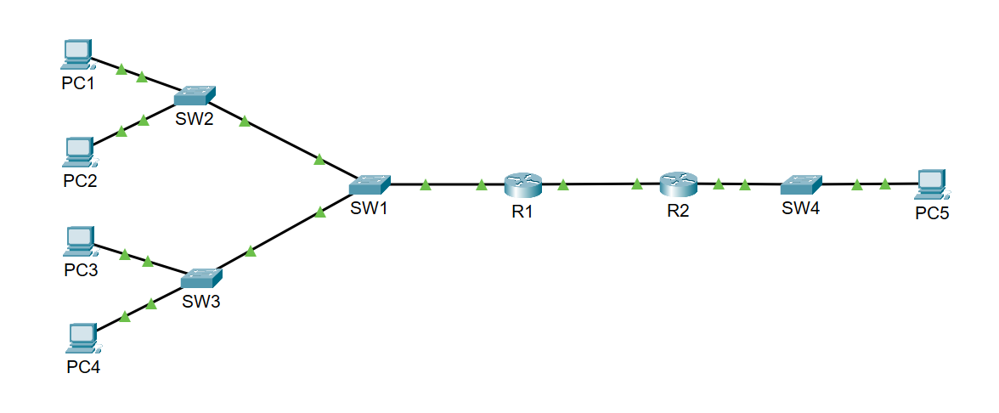
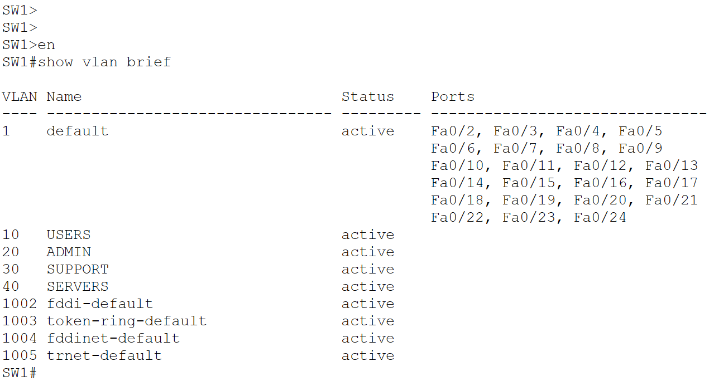
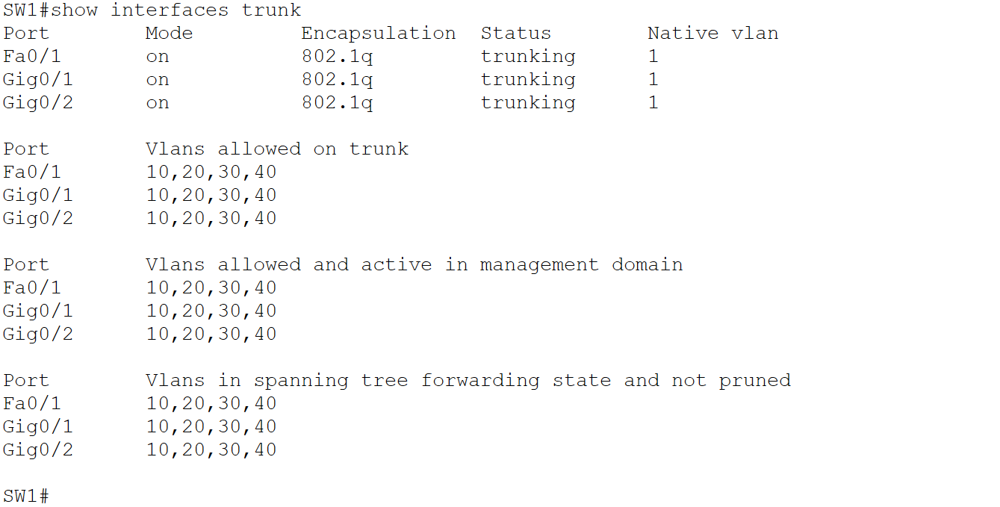
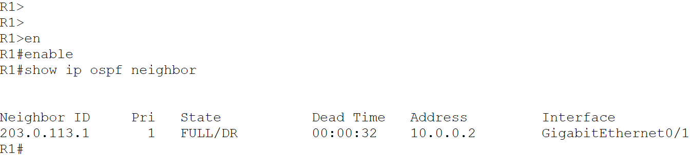
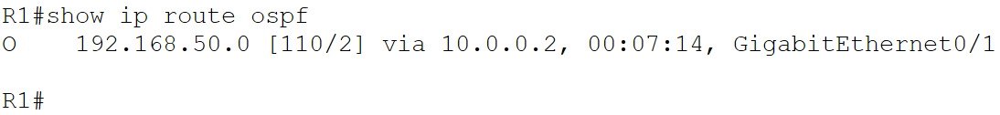
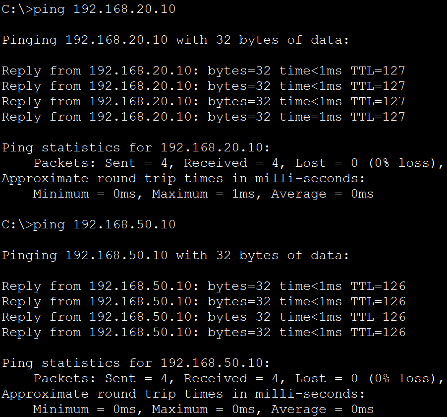
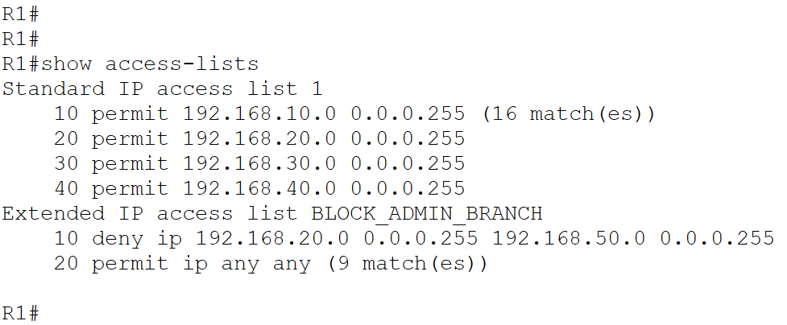
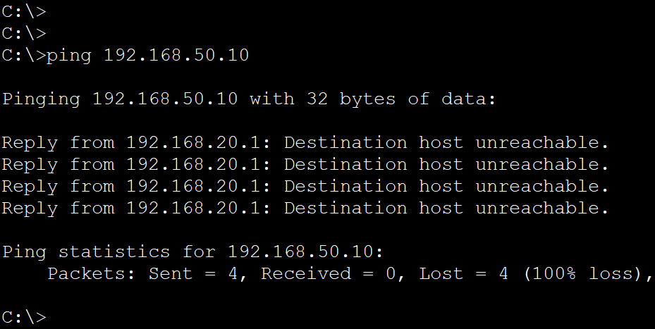
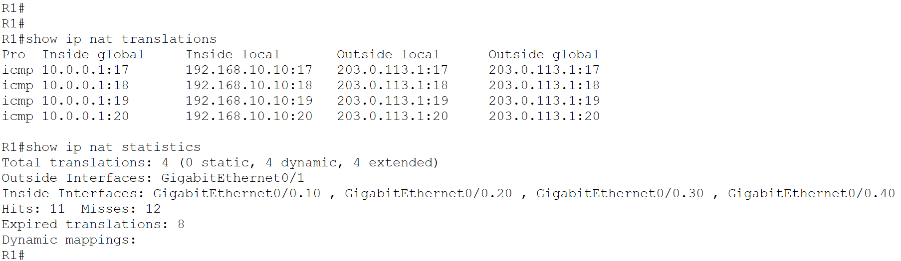
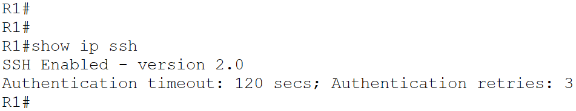

# Multi-Site Enterprise Network — Cisco Packet Tracer

## 1. Project Overview

This project demonstrates the design and configuration of a simulated multi-site enterprise network using Cisco Packet Tracer.

The network connects a Headquarter (HQ) environment with multiple VLANs to a branch network through a point-to-point WAN connection. The lab incorporates VLAN segmentation, inter-VLAN routing, dynamic routing, DHCP, NAT overload, access control, and secure remote device management.

The project focuses on building a segmented enterprise network, enabling communication between authorized networks, and validating network behavior through Cisco IOS commands and connectivity tests.

## 2. Project Objectives

- Design a multi-site enterprise network topology.
- Implement VLAN-based network segmentation at HQ.
- Configure 802.1Q trunking between network devices.
- Enable inter-VLAN routing using router-on-a-stick.
- Configure OSPF dynamic routing between routers.
- Implement DHCP for automatic client IP address allocation.
- Configure NAT overload (PAT).
- Apply extended ACLs to restrict selected network traffic.
- Enable SSH version 2 for secure remote device access.
- Validate network operation through CLI commands and connectivity testing.

## 3. Tools and Technologies

| Tool / Technology | Purpose |
|---|---|
| Cisco Packet Tracer | Network design and simulation |
| Cisco IOS CLI | Device configuration and verification |
| VLANs | Network segmentation |
| 802.1Q | VLAN trunking |
| Router-on-a-stick | Inter-VLAN routing |
| OSPF | Dynamic routing |
| DHCP | Automatic IP address allocation |
| NAT overload (PAT) | Network address translation |
| Extended ACL | Traffic filtering |
| SSH version 2 | Secure remote management |

## 4. Network Topology

The simulated network consists of three main components:

- **Headquarters (HQ):** Four VLANs supporting USERS, ADMIN, SUPPORT, and SERVERS.
- **WAN connection:** R1 and R2 connected through a point-to-point network using OSPF.
- **Branch network:** A separate LAN connected to R2.

### Network Topology Diagram



## 5. IP Addressing and VLAN Configuration

The HQ network is segmented into four VLANs. Each VLAN uses a separate IPv4 subnet and default gateway.

### VLAN and IP Addressing Table



| VLAN | Name | Network | Default Gateway |
|---|---|---|---|
| 10 | USERS | 192.168.10.0/24 | 192.168.10.1 |
| 20 | ADMIN | 192.168.20.0/24 | 192.168.20.1 |
| 30 | SUPPORT | 192.168.30.0/24 | 192.168.30.1 |
| 40 | SERVERS | 192.168.40.0/24 | 192.168.40.1 |
| — | Branch LAN | 192.168.50.0/24 | 192.168.50.1 |

### Inter-VLAN Routing

The HQ VLANs use router-on-a-stick inter-VLAN routing through R1.

The router provides gateway connectivity for the VLANs, allowing inter-VLAN communication according to the configured network policies.

## 6. Switching and Trunking

VLANs are used to logically segment the HQ network into separate broadcast domains.

802.1Q trunking is configured to carry VLAN traffic between network devices.

### Trunk Port Verification



The trunk configuration was verified using:

```text
show interfaces trunk
```

VLAN configuration was checked using:

```text
show vlan brief
```

## 7. Dynamic Routing — OSPF

OSPF is configured between R1 and R2 to exchange routing information between the HQ and branch networks.

The OSPF neighbor relationship and learned routes were verified through Cisco IOS CLI commands.

### OSPF Neighbor Verification



### Branch Route Verification



The following command was used to verify OSPF-learned routes:

```text
show ip route ospf
```

## 8. Network Services and Security

### DHCP

DHCP is configured to provide automatic IP address allocation to network clients.

This reduces the need for manual IP configuration on client devices.

### NAT Overload (PAT)

NAT overload is configured on R1.

The configuration allows multiple internal clients to use translated addressing through the configured NAT interface.

NAT operation was verified using:

```text
show ip nat translations
show ip nat statistics
```

### Extended ACL-Based Access Control

An extended access control list named `BLOCK_ADMIN_BRANCH` is configured to restrict ADMIN VLAN access to the branch network.

The ACL configuration and its behavior were validated through CLI output and connectivity testing.

### SSH Version 2

SSH version 2 is configured on R1 to provide secure remote device management.

SSH verification was performed using:

```text
show ip ssh
```

## 9. Network Validation and Testing

Network operation was verified using Cisco IOS commands and connectivity tests.

### Connectivity Tests



Ping tests were performed between HQ VLANs and the branch network to validate connectivity.

### ACL Configuration



The extended ACL configuration was reviewed using:

```text
show access-lists
```

### ACL-Blocked Connectivity Test



The blocked ping demonstrates the configured access restriction for ADMIN VLAN traffic to the branch network.

### NAT Translation Verification



NAT translation entries were inspected to verify address translation activity.

### SSH Version 2 Verification



SSH version 2 was verified, and SSH login from a PC to R1 was tested.

## 10. Verification Commands

The following Cisco IOS commands were used during configuration and validation:

| Command | Purpose |
|---|---|
| `show vlan brief` | Verify VLAN configuration |
| `show interfaces trunk` | Verify trunk interfaces |
| `show ip interface brief` | Check interface status and IP addressing |
| `show ip route ospf` | Verify OSPF-learned routes |
| `show ip nat translations` | Inspect NAT translation entries |
| `show ip nat statistics` | Verify NAT statistics |
| `show access-lists` | Review ACL configuration and matches |
| `show ip ssh` | Verify SSH status |

## 11. Skills Demonstrated

- Enterprise network design and simulation
- VLAN segmentation
- 802.1Q trunking
- Router-on-a-stick inter-VLAN routing
- IPv4 addressing and subnetting
- OSPF dynamic routing
- DHCP configuration
- NAT overload (PAT)
- Extended ACL configuration
- SSH version 2 configuration
- Cisco IOS CLI verification
- Network connectivity testing
- Technical documentation

## 12. Project Files

- `Multi_Site_Enterprise_Network.pkt` — Cisco Packet Tracer topology and configuration.
- `Packet_Tracer_Screenshots/` — Screenshots documenting the topology, configuration, and validation results.

## 13. How to Use This Lab

1. Download the `.pkt` file from this repository.
2. Open the file using Cisco Packet Tracer.
3. Inspect the network topology and device configurations.
4. Review the VLAN, routing, NAT, ACL, and SSH configurations.
5. Reproduce the connectivity tests.
6. Verify the results using the listed Cisco IOS commands.
